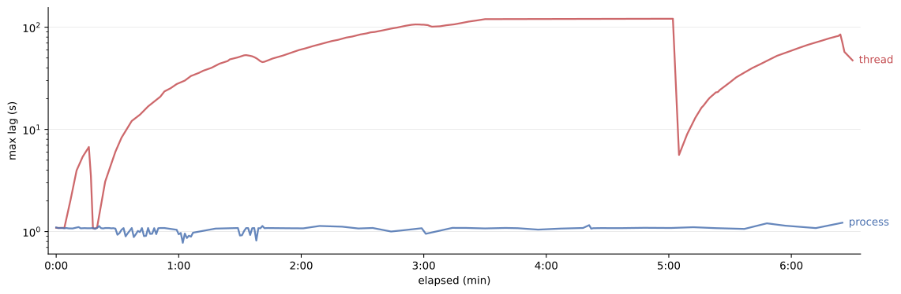

Just after lunch on a Monday, an alert fired: _FIX session disconnected_. That was new. The session dropped at 09:30 NY time — the US market open, when the accumulated pre-market orders execute and a significant share of the day's volume goes through in minutes. For a drop-copy session, a disconnection at the open is the expensive kind: trading carries on without you, and every trade that clears while you're not listening has to be found and confirmed by hand the next day. At the open, that's hundreds of trades per second.
A few weeks earlier, we'd routed more traffic through this session.
The service itself was unremarkable. Python 3.11, QuickFIX — C++ under the hood — handling the sessions, Postgres storing the trades. One pod, one CPU, nothing fancy.
And the dashboard said everything was fine.

It ran as a single Python process. One connection per venue, each feeding FIX messages in on its own ingest thread, which buffered them and wrote them to Postgres. A batch processor read those messages back out and turned them into trades.
That was the whole system: ingest threads accumulating messages, a processor draining them into trades, a database in between. It had run this way for a long time, quietly, without anyone needing to think about it.

The database is the reflex suspect, so I went there. I pulled the save-time histogram: 0–500ms, three-quarters under 100ms. It looked healthy — not pristine, but healthy. I poked the indexes, found nothing damning, ran a couple of faster-insert tricks (UNNEST won the local benchmark and changed nothing real), and moved on. The histogram already contained the answer. Batches arrived every ~330 ms and three-quarters of saves cleared in under 100 ms — the occasional 500 ms tail was debt the next couple of saves repaid. I didn't do that arithmetic at the time — I just saw a green-ish chart and crossed the database off. That's the habit worth naming, because I'm about to lean on it again: trust the dashboard, move on to the next suspect. Here it cost nothing — the database really was innocent. It didn't stay free.

The next cost that grows with message volume is parsing. Each message needs to be parsed — but parsing is core to QuickFIX, it runs in the C++ extension, and it's been polished by dozens of systems carrying far heavier loads than ours. The microbenchmarks said the same: parse 4.2µs, `toString` 3µs, prod-formatted log 21.6µs, call it 32µs per message with headroom. A heavy market open runs under 100,000 messages, so even at that ceiling the entire per-message compute budget for an open is around 3.2 seconds of CPU. The messages were being rejected as older than 120 seconds — QuickFIX's default cutoff — so the backlog was at least two minutes deep. Compute fell short of the symptom by a factor of nearly forty — per-message work was not the constraint.
The save tails told a different story. At market open they clustered around multiples of 100ms — 103.99, 211.37, 306.12, 325.97, 334.94ms against a 30–80ms median — the textbook CFS-throttling signature, 100ms being the scheduler period. CPU demand at open was running at about 2× the one-core allocation. So I raised the limit from one core to two and a half, on the same day.

The next day was clean. For two more days it looked solved. The following Monday, the FIX session disconnected at market open. The bump had bought three days, not a fix. And the tell was in the gap: the saturation alarm had gone quiet — CPU utilisation looked fine now — but the lag came back anyway. There was headroom, and it didn't help. Whatever the ceiling was, it wasn't compute.

The next suspect was logging. Every incoming FIX message was being logged — about 70k of the ~100k messages in a ten-minute open.
My prior was that logging couldn't be it — the same battle-tested pipe every system here has used for years. You don't expect to be the one who breaks it. A local reproduction changed that: under a deliberately slow sink, lag grew with volume. Sync writes to a full pipe block, and an open is precisely when volume spikes. At one point that pushed my confidence to near 90% — high enough to warrant a definitive test, not a hunch.
So I stripped it back: FIX logging off, most other levels downgraded. Logged volume fell ~20x, to ~5k total in the same window. The next open lagged just the same. Twenty times less logging, identical result — not logging.

Eventually I stopped looking for causes and built the metric that actually mattered: the time between a message leaving the venue (tag 52, its sending timestamp) and the moment QuickFIX hands the message to our application code — the fromApp callback. I called it `lag_ms`, and it isn't an arbitrary metric — it's the exact quantity QuickFIX checks when deciding a session has gone stale.
The meter ran at the next market open:

```
13:30:38.095 count=100 avg=0.73ms max=9.60ms   lag_max=12092.26ms
13:30:45.775 count=100 avg=3.09ms max=245.95ms lag_max=16775.23ms
13:30:57.269 count=100 avg=0.61ms max=11.06ms  lag_max=25269.37ms
13:31:03.749 count=100 avg=3.05ms max=246.71ms lag_max=30047.58ms
```

Look at the accounting. Across these 26 seconds we processed ~400 messages at single-digit-millisecond averages — less than a second of measurable work, even counting the ugly 245ms outliers. Meanwhile the lag grew by eighteen seconds. Over 95% of the elapsed time had no explanation: not in the database, not in the handlers, not in parsing. And CPU utilisation sat at 0.4 of its 2.5-core limit — there was idle compute everywhere.

Fast work, spare CPU, and a queue growing by the second. The thread wasn't slow at its job. It was being kept from its job — waiting on something none of my work-rate meters could see.

Every subsystem looked innocent in isolation. Either every measurement was lying, or the bottleneck existed between them.

This particular app serves a few different FIX connections, and most of the application initialisation involves setting their configurations. The long list of FIX engine initialisers ended with… `FixMessageProcessor`.

The `FixMessageProcessor` is designed to be independent of any FIX connections. It reads saved messages from the database and processes them. It's similar to the outbox pattern. It could even be a different program with shared access to the database, but here it sits in the same process with other connections.

A single process means a single interpreter lock — the GIL; the ingest thread must reacquire it for every message it touches; a peer that's constantly crunching wins those races here; the queue ages while the CPU idles. 2.5 cores with 0.4 utilisation, so the process is stuck around 1 core of usage. The most a single Python interpreter can ever use. The pod had spare CPU; the interpreter didn't.

For the first time I had a hypothesis that explained both the idle CPU and the growing queue. Even if the problem wasn't resolved, moving it out of the process would be a good architectural step. The change was trivial: swap `threading.Thread` for `mp.Process`. Another hypothesis was ready to test. I blocked out the next market open and waited.

```
13:30:30.536 count=100 avg=0.22ms max=0.54ms lag_max=1089.59ms
13:30:31.040 count=100 avg=0.21ms max=0.43ms lag_max=1040.26ms
13:30:31.679 count=100 avg=0.20ms max=0.37ms lag_max=1087.57ms
13:30:32.254 count=100 avg=0.20ms max=0.36ms lag_max=1087.30ms
```

Here we are: the lag dropped from almost two minutes to the floor of the meter — tag 52 carries whole seconds, so the max can't settle below ~1s. The unbounded climb (the hallmark of arrival > drain) has disappeared — ingestion now keeps pace with the venue at the open. And here's the part worth dwelling on — one extra process in the same pod, and CPU barely moved. Same messages, same compute. What collapsed was the lag, by well over an order of magnitude. The bottleneck was never the CPU. It was the wait.

It looked great, but this wasn't the first time a change has led to short-term success. 

Another Monday, 09:30 NY time, market open, I had the dashboard up, refreshing the page every few seconds. First reading: around 1s. That had happened before on a slow open, so I waited. One minute, still ~1s. Three minutes, seven minutes — processed-message count climbing, max lag flat. A win.

<figure>
  
  <figcaption>
    <i>Production max lag at the open (log scale): thread mode before the fix, process mode after. The red climb flattens at the engine's 120s MaxLatency — anything older is rejected ("SendingTime accuracy problem"), so the meter only sees what survives. Sustained rejections end in logout after ~5 minutes; on reconnect the venue replays its buffered backlog and the lag jumps straight back, draining only once the open flow ends. Blue holds at the meter's ~1s floor throughout.</i>
  </figcaption>
</figure>

Production was fixed, but "fixed" and "understood" are different states — the GIL was still a hypothesis, and prod would never let me prove it. At this point the story splits. Operationally, the incident was over. Technically, it was just becoming interesting.

Every layer I could measure had been acquitted, and yet two threads sharing a process had cost me two minutes of lag. In production that was where the road ended: the app handles sensitive data, and attaching `py-spy` to it was not a conversation I was going to win. So the next step was to rebuild the failure locally.

Here is a model with a few knobs — arrival rate (`RATE`), the size of the processor's work (`HOLD_SIZE`), the number of holds per cycle (`HOLDS_PER_CYCLE`) — turning those knobs reproduces the same behaviour and the same failure. An ingest thread blocks on recv for each message and records `now - sent_at` — the same shape as the QuickFIX callback loop: one interpreter re-entry per message. A processor thread does what the real one did — a socket round-trip, then building and `json.dumps`-ing a large structure to reproduce the execution profile. A paced producer and a DB stub run in separate processes, so neither can be victim or culprit. The only thing ingest and processor share is the interpreter.

The script uses Python 3.11; on 3.12 the runaway is shallower but still unbounded at this rate. It takes one argument: 
- `thread` runs the processor as a daemon thread — production before the fix;
- `process` runs the identical function in its own process — production after. 

```python
import json, socket, struct, sys, threading, time
import multiprocessing as mp

DB_ADDR = ("127.0.0.1", 5001)
FEED_ADDR = ("127.0.0.1", 5002)
MSG = struct.Struct("d")

# knobs
RATE = 600
HOLD_SIZE = 200_000
HOLDS_PER_CYCLE = 200

def db_stub():
    srv = socket.socket()
    srv.setsockopt(socket.SOL_SOCKET, socket.SO_REUSEADDR, 1)
    srv.bind(DB_ADDR)
    srv.listen()

    def serve(conn):
        with conn:
            while conn.recv(1):
                time.sleep(0.002)
                conn.sendall(b"\x01")

    while True:
        c, _ = srv.accept()
        threading.Thread(target=serve, args=(c,), daemon=True).start()

def producer():
    time.sleep(0.5)
    c = socket.create_connection(FEED_ADDR)
    nxt = time.monotonic()
    while True:
        c.sendall(MSG.pack(time.monotonic()))
        nxt += 1.0 / RATE
        d = nxt - time.monotonic()
        if d > 0:
            time.sleep(d)

def processor():
    c = socket.create_connection(DB_ADDR)
    while True:
        c.sendall(b"\x01")
        c.recv(1)
        for _ in range(HOLDS_PER_CYCLE):
            json.dumps([{"id": i, "v": f"x{i}"} for i in range(HOLD_SIZE)])

def recv_exact(conn, n):
    buff = b""
    while len(buff) < n:
        chunk = conn.recv(n - len(buff))
        if not chunk:
            raise ConnectionError
        buff += chunk
    return buff

def ingest():
    srv = socket.socket()
    srv.setsockopt(socket.SOL_SOCKET, socket.SO_REUSEADDR, 1)
    srv.bind(FEED_ADDR)
    srv.listen()
    conn, _ = srv.accept()
    lags = []
    while True:
        (sent, ) = MSG.unpack(recv_exact(conn, MSG.size))
        lags.append(time.monotonic() - sent)
        if len(lags) == 100:
            print(
                f"lag_avg={sum(lags) / 100 * 1000:8.1f}",
                f"lag_max={max(lags) * 1000:8.1f}"
            )
            lags = []

if __name__ == '__main__':
    mode = sys.argv[1] if len(sys.argv) > 1 else "thread"
    mp.Process(target=db_stub, daemon=True).start()
    mp.Process(target=producer, daemon=True).start()
    time.sleep(0.2)
    if mode == "thread":
        threading.Thread(target=processor, daemon=True).start()
    elif mode == "process":
        mp.Process(target=processor, daemon=True).start()
    else:
        raise SystemExit(f"unknown mode: {mode}")
    ingest()
```

Output:

```
# thread
lag_avg=    90.9 lag_max=   199.4
lag_avg=   251.7 lag_max=   394.4
lag_avg=   526.5 lag_max=   641.5
lag_avg=   728.7 lag_max=   856.2
lag_avg=   916.7 lag_max=   977.5
lag_avg=  1011.9 lag_max=  1086.0

... 6 mins later

lag_avg=166577.3 lag_max=166726.6
lag_avg=166927.3 lag_max=167113.9
lag_avg=167260.8 lag_max=167445.3
lag_avg=167591.0 lag_max=167785.0
lag_avg=167930.0 lag_max=168045.9

# process
lag_avg=     0.1 lag_max=     0.1
lag_avg=     0.1 lag_max=     0.1
lag_avg=     0.1 lag_max=     0.2

... 6 mins later

lag_avg=     0.1 lag_max=     0.1
lag_avg=     0.1 lag_max=     0.1
lag_avg=     0.1 lag_max=     0.1
```

Notice the thread run sails past 168 seconds. Production never showed a number like that: at 120s QuickFIX starts rejecting anything older; the flat-top on the production chart is that reject ceiling, and the cliff after it is the logout. The repro has nobody to disconnect it — this is the first look at the runaway uncapped.

Two threads, one interpreter, one lock. Only the holder executes Python bytecode; the other waits. And they want opposite things from it. Ingest needs the lock briefly but constantly — a few microseconds per message to read a timestamp, hundreds of times a second; its `recv` calls release the GIL during the syscall and reacquire it to hand the bytes back to Python. The processor takes the lock in bulk and lets go rarely. So while the processor holds it, ingest starves: the syscalls finish quickly, but the results can't get back into Python until the holder yields — messages age in the buffer while the CPU sits idle.

So what decides when the lock changes hands? `switchinterval` (default `0.005s`): how long a waiting thread lets the holder run before asking it to step aside. The holder obliges at its next bytecode boundary — which means how long a thread actually keeps the GIL depends on its boundaries, not on the interval.

That's why the processor's two phases behave differently. Building the list is pure-Python bytecode: it hits a boundary every few instructions and yields promptly once asked. Each `json.dumps` call is a single C call with no boundaries inside it (Python 3.11, no `indent`) — it holds the GIL start to finish, and the handoff stalls until it returns. The comprehension is the cooperative chunk; the dumps are the unyielding chunks that produce the spikes.

Lowering `switchinterval` makes a useful probe. The dumps stay uninterruptible at any interval. The cooperative phases, though, can be interrupted ten times as often at a tenth of the interval — and each interruption costs the listcomp only the microseconds ingest actually spends. At `0.0005s`:

```
lag_avg=    30.7 lag_max=    82.6
lag_avg=    36.9 lag_max=    82.7
lag_avg=    44.6 lag_max=    81.8

... 6 mins later

lag_avg=    46.9 lag_max=    85.9
lag_avg=    33.2 lag_max=    82.0
lag_avg=    44.6 lag_max=    86.9
```

The lag still spikes to roughly one `json.dumps` freeze (~72ms at this `HOLD_SIZE`, measured standalone) — but it drains in the next cooperative window instead of compounding. Flat instead of climbing. The probe has split the lag in two: the part that responded to the interval was time spent waiting to reacquire; the part that didn't move is the uninterruptible hold.

```
schematic, not to scale, each `|` is a handoff to ingest
interval 5ms:    [listcomp....]|[xxx dumps xxx][listcomp....]|[xxx dumps xxx]
interval 0.5ms:  [lc]|[lc]|[lc]|[lc]|[xxx dumps xxx][lc]|[lc]|[lc]|[lc]|
```

It's a probe, not a fix. A shorter interval means the GIL changes hands more often, and every handoff costs something — lowering it globally just buys overhead and slows genuinely CPU-bound work. What it bought here is a diagnosis: one lever, and the lag decomposed into reacquisition and hold. Process isolation — the change already running in production — kills both.

## Takeaways

The cost was waiting, not working. A co-resident thread with a heavier payload didn't out-compute the ingest threads — it out-held them. And the time they spent waiting for the GIL appeared on no meter, because work-rate meters count work done and waiting produces none. That's not a gap in the tooling; it's what those meters are, by construction.

Two modes, one sentence: at bytecode boundaries the victim pays per handoff; inside a C-extension hold the perpetrator extorts per hold. Separation kills both — which is why isolating the threads is the fix, not a tuning exercise.

Operationally: measure end-to-end age. Component throughput tells you each part is moving; only age tells you the system is keeping up.

Do I still trust the dashboards? Yes — to answer the questions they measure. I've just stopped asking them the one they can't.
